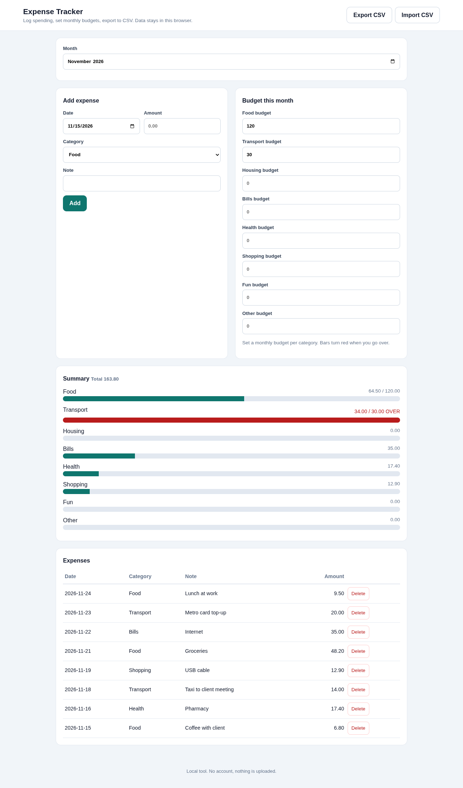

# Expense Tracker

_Screenshot of the tool with sample data entered through the page (fictional names and numbers)._

Log spending by category, set a monthly budget per category, see bars turn red when you go over, export and import CSV.

## What it does
- Add, delete and list expenses with date, category and note
- Monthly view with totals per category and budget bars (red when over)
- CSV export, and CSV import that skips invalid rows and duplicates and tells you how many
- Validation: no negative, zero or non-numeric amounts
- Data saved in the browser (localStorage) and kept after reload

## Run it
Open `index.html` in a browser. No install, no build, no server, no account.

## Tests and limits
- Browser-tested in headless Chrome: 13 checks passed on the current code (they include a mobile layout check, which only proves nothing overflows).
- Data stays in this browser. Clearing site data deletes it. No sync between devices.
- Plain HTML, CSS and JavaScript, no frameworks.

Built by Mahamed Yasser.
